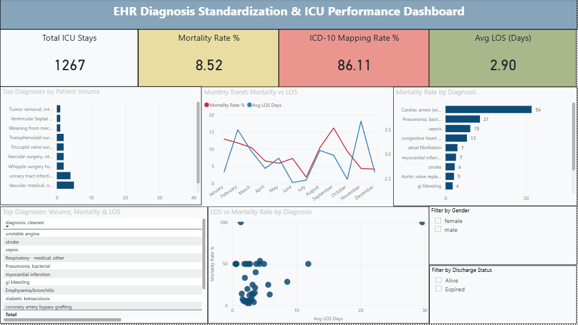

# EHR Diagnosis Standardization & ICU Performance Dashboard

*Built during my AI Data Quality Analyst Trainee role at Rooman Technologies (Feb–Jun 2025) — NASSCOM Certified, Grade A, NSQF Level 5.*

An end-to-end data pipeline that cleans free-text clinical diagnoses from ICU records, maps them to ICD-10 codes using NLP and fuzzy matching, performs SQL-based analytics, and visualises outcomes in a Power BI dashboard.

---

## Dashboard Preview



---

## Project Overview

| Item | Detail |
|---|---|
| **Dataset** | eICU Collaborative Research Database |
| **Records Processed** | 1,267 ICU patient stays |
| **ICD-10 Mapping Rate** | 86.11% |
| **Mortality Rate** | 8.52% |
| **Avg ICU Length of Stay** | 2.90 days |

---

## Tech Stack

`Python` · `spaCy` · `fuzzywuzzy` · `pandas` · `MySQL` · `Power BI`

---

## Repository Structure

```
ehr-diagnosis-standardization/
├── EHR_Project.ipynb         # Full Python pipeline (NLP → ICD-10 mapping → EDA)
├── ehr_nlp_queries.sql       # MySQL schema + 6 analytical queries
├── EHR_Dashboard.pbix        # Interactive Power BI dashboard
├── ICU_Dashboard.png         # Power BI dashboard screenshot
└── README.md
```

---

## Pipeline Steps

### 1. Data Loading & Cleaning
- Loaded 1,267 ICU patient records from the eICU dataset
- Standardised column names, normalised gender values, handled 180 null diagnosis records

### 2. Text Cleaning & NLP (spaCy)
- Applied `en_core_web_sm` model to tokenise and clean free-text `apacheadmissiondx` field
- Removed noise, punctuation, and inconsistent casing from raw diagnosis strings

### 3. Fuzzy Matching & Diagnosis Standardisation (fuzzywuzzy)
- Matched raw diagnosis text against a curated medical reference list
- Resolved variant spellings and abbreviations into a consistent `diagnosis_cleaned` field

### 4. ICD-10 Code Mapping
- Built a custom mapping dictionary using the `simple-icd-10` library
- Achieved **86.1% mapping coverage**; unmapped cases documented for review

### 5. SQL Analytics (MySQL)
Six production queries covering:

| # | Query | Technique |
|---|---|---|
| 1 | Diagnosis frequency & ICD-10 coverage rate | Window functions (`OVER()`) |
| 2 | Mortality rate by diagnosis | Conditional aggregation |
| 3 | Gender & ethnicity distribution per diagnosis | Pivot-style aggregation |
| 4 | Average ICU length of stay with deviation ranking | CTE + `RANK()` |
| 5 | Monthly admission trend + rolling 3-month average | `ROWS BETWEEN` window frame |
| 6 | 30-day readmission risk flagging | `LAG()` + `DATEDIFF()` |

### 6. Power BI Dashboard
- KPI cards: Total ICU Stays, Mortality Rate %, ICD-10 Mapping Rate %, Avg LOS (Days)
- Charts: Top diagnoses by volume, monthly mortality vs LOS trend, mortality rate by diagnosis bar chart, LOS vs mortality scatter plot
- Filters: Gender, Discharge Status (Alive / Expired)

---

## Key Findings

- **1,267 ICU records** processed end-to-end through the NLP pipeline
- **86.1% ICD-10 mapping rate** achieved after fuzzy matching and manual dictionary expansion
- **180 null diagnosis entries** resolved through standardisation
- **Cardiac arrest** had the highest patient volume (54) among mapped diagnoses
- **Top diagnoses by volume:** sepsis (195), GI bleeding (90), diabetic ketoacidosis (60)
- Mortality and LOS showed no strong linear correlation across diagnoses, indicating diagnosis type alone is insufficient to predict ICU outcomes

---

## How to Run

### Python Pipeline
```bash
pip install spacy fuzzywuzzy python-Levenshtein simple-icd-10 pandas matplotlib seaborn
python -m spacy download en_core_web_sm
jupyter notebook EHR_Project.ipynb
```

### SQL Queries
```sql
SOURCE ehr_nlp_queries.sql;
```
> Update the `LOAD DATA LOCAL INFILE` path to point to your local `cleaned_ehr_data.csv`.

### Power BI Dashboard
Open `EHR_Dashboard.pbix` in Power BI Desktop.

---

*Part of my Data Analyst portfolio — [LinkedIn](https://linkedin.com/in/ankita-halabanur) · [GitHub](https://github.com/ankita-halabanur)*
